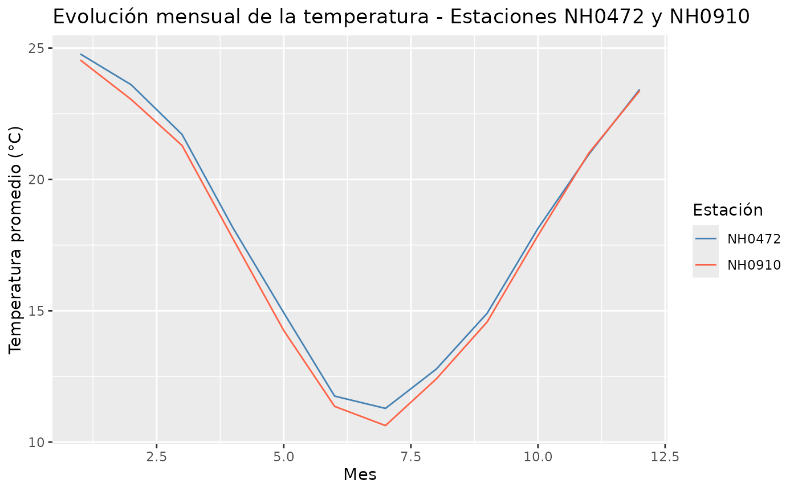

# Paquete meteorológico: queRemosapRobar

## Introducción

El paquete `queRemosapRobar` proporciona herramientas para la lectura,
estructuración, análisis y visualización de datos meteorológicos
provenientes de estaciones de medición. Esta viñeta muestra un flujo de
trabajo básico utilizando las funciones principales del paquete:

1.  **Lectura e Importación de Datos** (`lectura_datos`)
2.  **Datos incluidos en el paquete**
3.  **Integración y combinación de datasets**
4.  **Conteo de Observaciones Válidas** (`conteo_obs_temp`)
5.  **Resumen Estadístico de Temperatura** (`tabla_resumen_temperatura`)
6.  **Temperaturas Extremas por Estación**
    (`extremos_temperatura_estacion`)
7.  **Temperatura Promedio Anual** (`temperatura_promedio_anual`)
8.  **Visualización de la Evolución Mensual**
    (`grafico_temperatura_mensual`)

### Lectura e Importación de Datos

La función
[`lectura_datos()`](https://manuelabulgubure.github.io/queRemosapRobar/reference/lectura_datos.md)
permite descargar e importar un archivo CSV con mediciones climáticas a
partir del identificador de la estación. Si el archivo ya existe en tu
equipo local, lo lee directamente. Este ejemplo no se ejecuta al
construir la viñeta porque requiere conexión a internet; el resto del
flujo usa los datos que ya vienen incluidos en el paquete
(`estacion_472` y `estacion_910`).

``` r

# Ejemplo de lectura para la estación "NH0437"
datos_clima <- lectura_datos(id = "NH0437", ruta = "NH0437.csv")

# Inspección básica de los datos cargados
head(datos_clima)
```

### Datos incluidos en el paquete

El paquete `queRemosapRobar` incluye tres conjuntos de datos
incorporados de forma nativa, listos para usar en cuanto se carga la
librería con
[`library(queRemosapRobar)`](https://github.com/ManuelaBulgubure/queRemosapRobar):

| Objeto | Descripción |
|:---|:---|
| `metadatos` | Información descriptiva de 258 estaciones meteorológicas: nombre, tipo, localidad, provincia, coordenadas, altura y período de registro (11 variables). |
| `estacion_472` | Registros diarios de la estación NH0472: temperaturas, humedad, viento, precipitaciones, radiación y otras variables agrometeorológicas (35 variables). |
| `estacion_910` | Registros diarios de la estación NH0910, con las mismas 35 variables que `estacion_472`. |

> Para consultar la documentación detallada y la estructura de cada
> variable, podés ejecutar en la consola
> [`?metadatos`](https://manuelabulgubure.github.io/queRemosapRobar/reference/metadatos.md),
> [`?estacion_472`](https://manuelabulgubure.github.io/queRemosapRobar/reference/estacion_472.md)
> o
> [`?estacion_910`](https://manuelabulgubure.github.io/queRemosapRobar/reference/estacion_910.md).

------------------------------------------------------------------------

### Integración y combinación de datasets

Un caso de uso habitual en análisis meteorológico consiste en unificar
los registros diarios provenientes de distintas estaciones de medición y
cruzarlos posteriormente con la tabla descriptiva de `metadatos`.

#### 1. Apilar mediciones con `rbind()`

Como `estacion_472` y `estacion_910` comparten exactamente la misma
estructura de 35 columnas, podemos combinarlas verticalmente de forma
limpia y eficiente utilizando
[`rbind()`](https://rdrr.io/r/base/cbind.html) de R base:

``` r

# Apilamos los registros diarios de ambas estaciones
datos_diarios_unificados <- rbind(estacion_472, estacion_910)
```

#### 2. Cruzar con metadatos según el objetivo del análisis

Una vez unificados los registros diarios, podemos enriquecer la
información asociando los metadatos de cada estación mediante la columna
común id. Según la estrategia de análisis, se pueden aplicar dos tipos
de uniones:

Opción A: Unión completa con full_join() (Recomendado) Conserva la
totalidad de los registros de ambas tablas. Si una estación figura en
los metadatos pero no posee registros diarios asociados (o viceversa),
se mantendrá en el dataset resultante rellenando los campos vacíos con
NA. Es la alternativa ideal para preservar la integridad de los datos
sin perder información.

``` r

# Conserva todas las filas y metadatos disponibles
datos_completos <- datos_diarios_unificados |> 
  full_join(metadatos, by = "id")
```

Opción B: Unión interna con inner_join() (Filtrado de volumen) Retiene
únicamente las filas cuyas estaciones estén presentes de forma
simultánea en ambas tablas. Es una excelente opción cuando se busca
reducir el volumen de datos de trabajo o descartar registros huérfanos
sin mediciones válidas.

``` r

# Retiene únicamente las coincidencias exactas entre tablas
datos_filtrados <- datos_diarios_unificados |> 
  inner_join(metadatos, by = "id")
```

------------------------------------------------------------------------

### Conteo de Observaciones Válidas

Para verificar la calidad y disponibilidad de los datos registrados a
distintas alturas o profundidades por cada estación, utilizamos la
función
[`conteo_obs_temp()`](https://manuelabulgubure.github.io/queRemosapRobar/reference/conteo_obs_temp.md):

``` r

# Calcular el conteo de observaciones válidas
conteo_obs <- conteo_obs_temp(datos_diarios_unificados)

# Mostrar el resultado
conteo_obs
#> # A tibble: 2 × 4
#>   id     temp_150cm temp_5cm temp_10cm_media
#>   <chr>       <int>    <int>           <int>
#> 1 NH0472      20359    15504               0
#> 2 NH0910      15506        0               0
```

------------------------------------------------------------------------

### Resumen Estadístico de Temperatura

Con la función
[`tabla_resumen_temperatura()`](https://manuelabulgubure.github.io/queRemosapRobar/reference/tabla_resumen_temperatura.md),
podemos obtener una tabla agrupada por estación (`id`) que calcula la
temperatura promedio, mínima y máxima (a 150 cm de altura):

``` r

# Cálculo de tabla resumen
resumen_temp <- tabla_resumen_temperatura(datos_diarios_unificados)

# Mostrar el resultado
resumen_temp
#> # A tibble: 2 × 4
#>   id     temp_promedio temp_minima temp_maxima
#>   <chr>          <dbl>       <dbl>       <dbl>
#> 1 NH0472          18.0        0.55        34.8
#> 2 NH0910          17.7        0           35.2
```

------------------------------------------------------------------------

### Temperaturas Extremas por Estación

La función
[`extremos_temperatura_estacion()`](https://manuelabulgubure.github.io/queRemosapRobar/reference/extremos_temperatura_estacion.md)
permite identificar los valores mínimos y máximos absolutos registrados
a diferentes alturas, facilitando la detección de eventos térmicos
destacados:

``` r

# Cálculo de temperaturas extremas
extremos_estacion <- extremos_temperatura_estacion(datos_diarios_unificados)

# Mostrar el resultado
extremos_estacion
#> # A tibble: 2 × 5
#>   id     temp_minima_150cm temp_maxima_150cm temp_minima_50cm temp_minima_5cm
#>   <chr>              <dbl>             <dbl>            <dbl>           <dbl>
#> 1 NH0472              -8                42.1               -8           -13.6
#> 2 NH0910              -8.5              43                 NA            NA
```

------------------------------------------------------------------------

### Temperatura Promedio Anual

Si nuestro objetivo es realizar un seguimiento a mayor escala temporal,
podemos extraer los años a partir de las fechas y calcular la
temperatura de abrigo promedio anual por estación mediante
[`temperatura_promedio_anual()`](https://manuelabulgubure.github.io/queRemosapRobar/reference/temperatura_promedio_anual.md):

``` r

# Cálculo del promedio anual
promedio_anual <- temperatura_promedio_anual(datos_diarios_unificados)

# Mostrar el resultado
promedio_anual
#> # A tibble: 100 × 3
#>    id      anio temp_promedio
#>    <chr>  <dbl>         <dbl>
#>  1 NH0472  1961          17.0
#>  2 NH0472  1962          17.1
#>  3 NH0472  1963          17.8
#>  4 NH0472  1964          17.5
#>  5 NH0472  1965          17.3
#>  6 NH0472  1966          17.1
#>  7 NH0472  1967          17.5
#>  8 NH0472  1968          17.8
#>  9 NH0472  1969          18.0
#> 10 NH0472  1970          17.8
#> # ℹ 90 more rows
```

------------------------------------------------------------------------

### Visualización de la Evolución Mensual

Para analizar el comportamiento temporal de la temperatura a lo largo
del año, utilizamos
[`grafico_temperatura_mensual()`](https://manuelabulgubure.github.io/queRemosapRobar/reference/grafico_temperatura_mensual.md).
Esta función genera un gráfico de líneas construido sobre `ggplot2`.

``` r


# Generar el gráfico mensual de la estación

grafico_temperatura_mensual(
  data_frame = datos_diarios_unificados, 
  colores = c("steelblue", "tomato"),
  titulo = "Evolución mensual de la temperatura - Estaciones NH0472 y NH0910"
)
```


